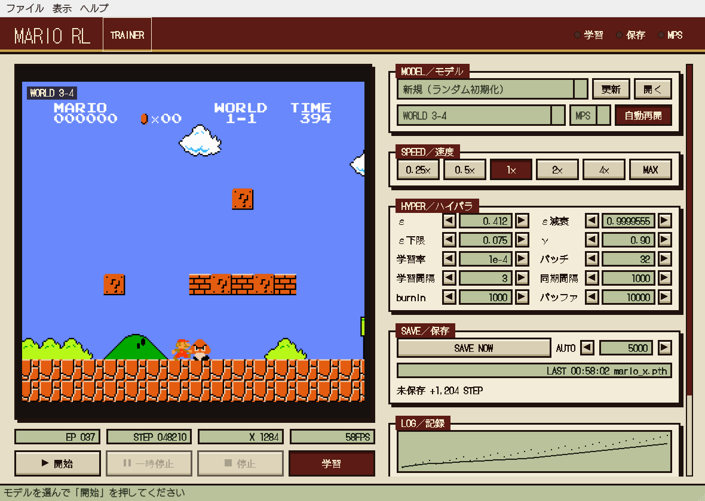

# RL_super_mario_bro

Super Mario Bros. を Q-learning（DQN）でプレイするプロジェクトです。
学習済みモデルの再生に加えて、アプリ上で DQN の学習を回せる macOS 向け GUI アプリを追加しました（見た目はファミコン風）。



## GUI アプリ（macOS）

元のノートブックは Colab / Linux 向けで `pyvirtualdisplay` を使っていましたが、
このアプリは macOS ネイティブの PySide6 ウィンドウに直接ゲーム画面を描画します。

### 必要なもの

- macOS 12 以降（Apple Silicon / Intel）
- [uv](https://docs.astral.sh/uv/)（`brew install uv`）
- 約 2 GB の空き容量（PyTorch を含む）

### かんたん起動

1. Finder で **`Mario RL Player.command`** をダブルクリック
2. 初回は自動で `.venv` を作成し、依存関係をインストールします（数分かかります）
3. ウィンドウが開いたら **「開始」**

ターミナルから起動する場合:

```sh
uv venv --python 3.13 .venv
uv pip install --python .venv/bin/python -r requirements.txt
.venv/bin/python run_app.py
```

### .app として起動

```sh
./scripts/build_app_bundle.sh
open "Mario RL Player.app"
```

`Mario RL Player.app` は `.venv` を参照する軽量なラッパーです（PyInstaller は使いません）。
アプリのログは `~/Library/Logs/MarioRLPlayer.log` に出力されます。

### 使い方

| 操作 | 説明 |
| --- | --- |
| MODEL | 先頭の「新規（ランダム初期化）」か、`.pth`（プロジェクト直下と `models/` を自動検出）を選ぶ。`⌘O` で別のファイルも選べる |
| ステージ | WORLD 1-1 〜 8-4。同梱モデルは **3-4** 用 |
| デバイス | MPS（使えれば既定）/ CPU。実行中は変更できない |
| 学習キー | ON で DQN 学習、OFF で再生のみ。新規モデルは ON、既存モデルは OFF が既定。実行中も切り替えられる |
| SPEED | 0.25× 〜 4×、MAX（待ちなし）。実行中に変更できる。1× は NES 実機と同じ 60 fps |
| HYPER | ε・ε減衰・ε下限・γ・学習率・バッチ・学習間隔・同期間隔・burnin・バッファを実行中に変更できる（◀▶、または値をクリックして直接入力） |
| SAVE | `SAVE NOW` で今すぐ保存、`AUTO` で自動保存の間隔（ステップ数、OFF 可） |
| Space / Return / Esc | 一時停止 / 開始 / 停止 |
| ⌘S | 重みを保存 |
| ⌘⇧S | スクリーンショットを `screenshots/` に保存 |

### アプリ内学習

- ノートブックの `Mario` クラスと同じ学習（ε-greedy、Double DQN 形式の TD ターゲット、SmoothL1、Adam）をアプリ内で動かします。
- 保存は `models/` に書き出します。手動は `mario_<日時>_s<ステップ>.pth`、自動は実行ごとに 1 ファイル（`mario_<開始日時>_auto.pth`）を上書きします。横に同名の `.json`（ハイパラ・ステップ数・シードなど）が付きます。元のモデルファイルは上書きしません。
- 形式は `MarioNet.state_dict()`（`online.*` / `target.*`）で、ノートブックと互換です。
- 保存から再開するとリプレイバッファは空から始まり、burnin の間は学習しません。
- リプレイバッファは uint8 で持ちます（1 万件で約 565 MB）。
- 学習中に停止・終了すると、未保存の更新があれば確認が出ます。

### 仕組み

- **前処理**: グレースケール → 84×84 → 直近 4 フレーム → 0–1 に正規化
- **行動**: `SIMPLE_MOVEMENT` の 7 種類を 12 フレームずつ実行
- **推論・学習**: `MarioNet`（3 層 CNN + 全結合）を MPS または CPU で実行
- **描画**: `nes-py` の `render_mode="rgb_array"` で取得した 256×240 の画面を Qt でウィンドウの大きさに合わせて拡大
- **報酬**: ノートブックの `CustomRewardAndDoneEnv` と同じ整形（前進 +10、後退 -4 など）

`pyvirtualdisplay` は不要です。ゲーム画面はワーカースレッドで取得し、
UI 側のタイマーが最新フレームを取り出して描画します（描画負荷でゲームループが止まらない構成）。

### 同梱モデルについて

`mario_param_new_best.pth` は 3-4 を 10 時間学習した時点のチェックポイントです。
学習途上のため、最初の溶岩地帯（x ≈ 430）で失敗することがあります。
ノートブックで学習を続けた場合も、アプリの **「モデル一覧を更新」** から読み込めます。

> 前処理は学習時（torchvision 0.13 の `T.Resize`）に合わせて **antialias なし**で縮小しています。
> antialias ありにすると入力分布が変わり、同じモデルでも挙動が悪化します。

### トラブルシューティング

| 症状 | 対処 |
| --- | --- |
| `uv: command not found` | `brew install uv` |
| モデル読み込みエラー | `MarioNet` の `state_dict`（`online.*` / `target.*`）か確認 |
| ウィンドウが開かない | `~/Library/Logs/MarioRLPlayer.log` を確認 |
| 動作が重い | 再生速度を 0.5x に下げる、他のアプリを閉じる |

Intel Mac でも動作します（PyTorch の x86_64 wheel がインストールされます）。

## ファイル構成

```
mario_app/
  hyperparams.py  ハイパラ（frozen dataclass）・範囲・刻み
  replay.py       uint8 の環状リプレイバッファ
  trainer.py      DQN 学習器（act / learn / sync）
  checkpoint.py   保存・JSON 横置き・モデル検出
  controls.py     UI からワーカーへ操作を渡す共有状態
  pacing.py       再生速度に応じたペーシング
  agent.py        MarioNet とチェックポイント読み込み
  env.py          前処理ラッパー・カスタム報酬・環境生成
  game_worker.py  QThread 上で動くゲームループ（学習を含む）
  paths.py        プロジェクト内のパス
  ui/             ファミコン調のメインウィンドウと部品
assets/fonts/     DotGothic16（SIL OFL）と OFL.txt
tests/            pytest（`QT_QPA_PLATFORM=offscreen .venv/bin/python -m pytest -q`）
run_app.py        起動スクリプト
scripts/
  build_app_bundle.sh  .app バンドル生成
  make_icon.py         アプリアイコン生成
  ui_snapshot.py       UI をオフスクリーンで PNG に保存
  train_smoke.py       MPS での学習スモーク
sakai_rl_mario.ipynb   元の学習ノートブック（Colab / Linux 想定）
mario_param_new_best.pth  学習済みモデル（3-4）
mario_param_new.pth       学習途中のモデル
movie_mario.mp4           プレイ動画
```

## 開発

```sh
uv pip install --python .venv/bin/python -r requirements-dev.txt
QT_QPA_PLATFORM=offscreen .venv/bin/python -m pytest -q
```

画面のフォントは [DotGothic16](https://github.com/fontworks-fonts/DotGothic16)（SIL Open Font License 1.1）を同梱しています。

## 元のノートブック

`sakai_rl_mario.ipynb` は元の Q-learning 実装です。
`gym`（旧 API）と `pyvirtualdisplay` を使っているため、そのままでは macOS では動きません。
このアプリでは `gymnasium` API に移植し、`SuperMarioBros-3-4-v0` + `JoypadSpace(SIMPLE_MOVEMENT)` で実行しています。

## 参考文献

- [gym-super-mario-bros](https://pypi.org/project/gym-super-mario-bros/)
- [nes-py](https://pypi.org/project/nes-py/)
- [zakopuro/RL_mario](https://github.com/zakopuro/RL_mario)
